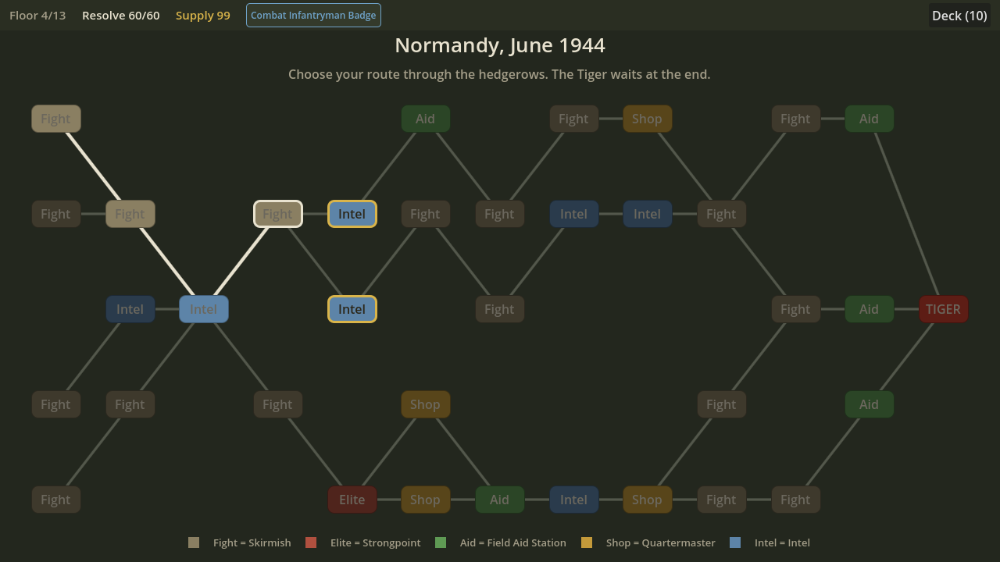
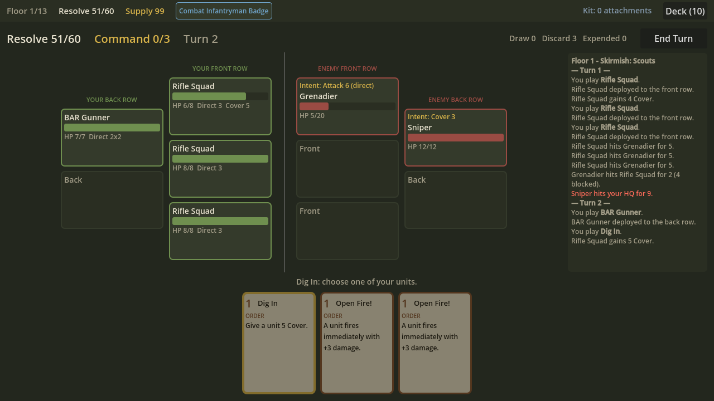
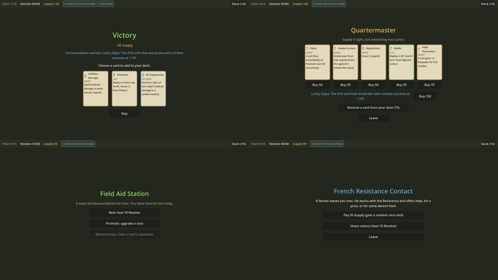
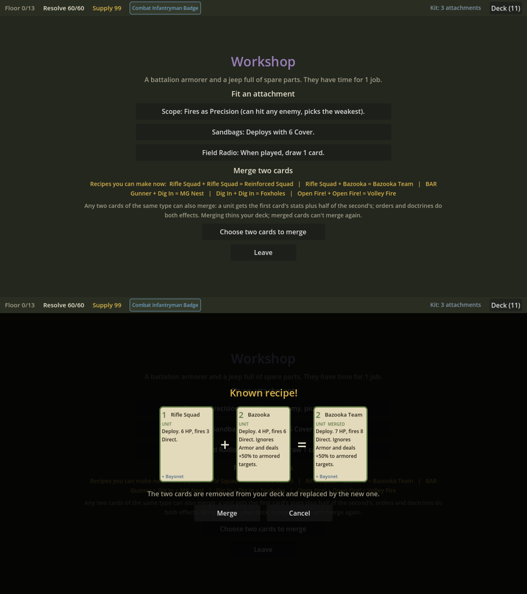

# Hedgerow

A WWII deck-building roguelike in the style of Slay the Spire, built in Godot 4.3. See [DESIGN.md](DESIGN.md).

**Status:** All five prototype milestones are done. You can play a full run: a branching 12-floor map through Normandy with fights, elites, rest stops, a shop, Workshops and random events, ending in a fight against a Tiger I tank. There are about 26 reward cards plus 9 merge-only cards, 11 enemies, 15 fights, 11 Commendations and 9 events. Graphics are placeholders.






## Play

Open `game/project.godot` in Godot 4.3+ and press **F5** (or run `godot --path game`).

- **Click** a card, then click a highlighted target, **or drag** the card onto the target.
- Cards with no target (Smoke Screen, Suppressing Fire…): click them twice, or drop them on the battlefield.
- **Right-click / Esc:** cancel. **Space / Enter / End Turn:** end your turn.
- Each enemy shows its next move ("Intent") above its name.
- **Map:** click a highlighted node to move there. The bar at the top shows Resolve, Supply, your Commendations (hover them for details) and your deck.

## Run the tests

```sh
GODOT=/path/to/godot game/tests/run.sh
```

## UI smoke test and screenshots

These need a display. On a headless Linux box, run them under `xvfb-run`.

```sh
xvfb-run godot --path game -s res://tools/ui_smoke.gd          # clicks and drags through the real UI
xvfb-run godot --path game -s res://tools/screenshot.gd -- out.png [map|combat|boss|reward|rest|shop|event|end] [seed]
```

## Balance simulator

A simple greedy bot plays the game:

```sh
godot --headless --path game -s res://tools/sim.gd -- fights 200   # starter deck vs each encounter
godot --headless --path game -s res://tools/sim.gd -- runs 300     # full runs through the map
```

## Layout

- `data/`: cards, enemies and encounters, Commendations, events, attachments and merge recipes as JSON. To add content, edit these files; no code needed.
- `core/`: game logic. Plain GDScript with no scenes, so it can be tested.
- `ui/`: the combat screen, built in code (`main.tscn` is the entry scene).
- `tests/`: headless test suite.
- `tools/`: dev scripts.
